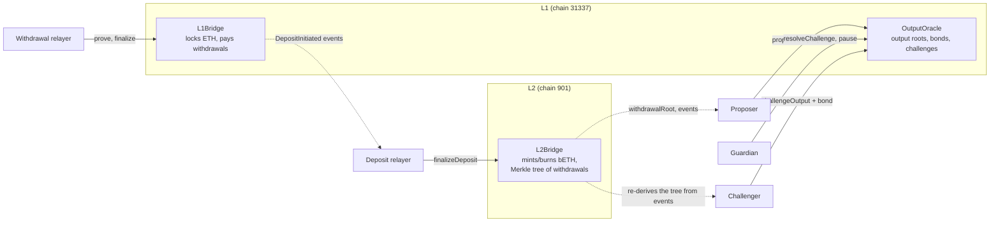
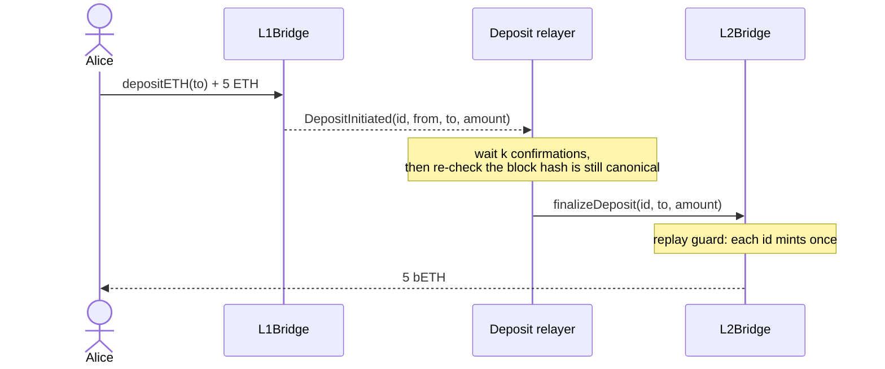
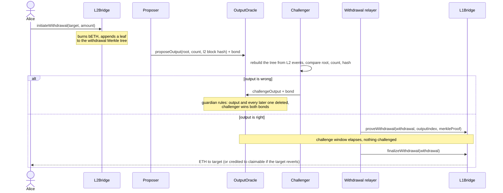

# rollup-bridge

An **optimistic-style ETH bridge** between two chains, built as a portfolio project: Solidity contracts (Foundry) and Java 25 services (Maven). L1 and L2 are two local Anvil chains. ETH locked on L1 is mirrored as an ERC-20 (`bETH`) on L2; withdrawals are proven with a Merkle proof against a posted *output root*, wait out a *challenge window*, and can be disputed by a watcher who posts a bond.

> **Educational project. Not audited, not for real value.** One component (the *guardian*) is a deliberate trusted party. See [SECURITY.md](SECURITY.md) and [docs/THREAT-MODEL.md](docs/THREAT-MODEL.md).

What a reader can verify in this repo:

- **Contracts**: 121 Foundry tests (unit, fuzz, invariants, and one named test per adversarial scenario), 100 % line/branch coverage of `src/`.
- **Java services**: hexagonal design (`core` has no I/O dependencies), sealed-type state machines, SQLite persistence, idempotent services that survive `kill -9`.
- **Differential tests**: the Java Merkle tree is checked bit for bit against Solidity (generated test vectors *and* the deployed contracts on a live Anvil).
- **Attack scenarios as tests**: malicious proposer, malicious challenger, relayer crash, **L1 reorg** (including the one where relaying at zero confirmations loses funds), reverting payout target, pause.
- **A demo** that runs the whole story in about a minute: [docs/DEMO.md](docs/DEMO.md) has the real captured output.

## Quickstart

Needs a JDK 25, [Foundry](https://getfoundry.sh) (`anvil`, `cast`, `forge`) and a POSIX shell (Git Bash works). No Docker.

```bash
git clone <this repo> && cd rollup-bridge
scripts/install-deps.sh          # forge-std + OpenZeppelin v5.4.0 into contracts/lib
./mvnw -T 1 verify               # builds the services and runs every Java test (needs anvil + forge on the PATH)
(cd contracts && forge test)     # the Solidity tests
scripts/demo.sh                  # two Anvils + deploy + services + deposit + withdrawal + a caught attack
```

`KEEP=1 scripts/demo.sh` leaves everything running; a plain-text status page is then on http://127.0.0.1:18088/ and `java -jar services/app/target/rollup-bridge.jar status` prints the same view.

## How it works

Two chains, two bridge contracts, and four off-chain actors.



### Deposit (L1 to L2)



### Withdrawal (L2 to L1)



### Trust model in five lines

1. **Safety (no theft) needs one honest, online challenger** per posted output, inside the challenge window. If nobody watches, a lying proposer can steal ([tested, on purpose](services/e2e/src/test/java/dev/rollupbridge/e2e/AttackScenariosTest.java)).
2. **The guardian is trusted** to rule on challenges correctly (MVP). It cannot move user funds on its own, but it can pause the bridge and decide disputes. A real system replaces it with an on-chain fault proof.
3. **The deposit relayer is trusted** to mirror L1 deposits; a bad relayer can mint unbacked bETH on L2, and L1 refuses to pay more than it holds.
4. **The owner** (Ownable2Step) can rotate roles and change caps; use a multisig and timelock in any real deployment.
5. **Finality of L1 matters**: the relayer mints only after `k` confirmations and re-checks the block hash; at `k = 0` an L1 reorg loses funds (test `e6_zeroConfirmations...`).

## Repository layout

```
contracts/          Foundry project: src/{l1,l2,lib,interfaces}, test/, script/ (deploy + vector generator)
services/
  core/             domain: Keccak-256, withdrawal tree, ABI codec, sealed state machines, ports. No I/O deps.
  adapters/         JSON-RPC client, tx signing (web3j-crypto), EVM gateways, SQLite store
  services/         deposit relayer, proposer, withdrawal relayer, challenger, guardian
  testkit/          native Anvil fixture, contract deployer, malicious proposer, fault injection
  app/              CLI entry point and wiring (shaded jar)
  e2e/              end-to-end scenarios and live differential tests
testdata/           tree-vectors.json, generated by Solidity, consumed by Java
scripts/            demo.sh, install-deps.sh
docs/               SPEC.md, THREAT-MODEL.md, DEMO.md
```

## Commands

| What | Command |
|---|---|
| Solidity tests | `cd contracts && forge test` (`FOUNDRY_PROFILE=ci forge test` for the exhaustive run) |
| Coverage | `cd contracts && forge coverage --no-match-coverage "script\|test" --report summary` |
| Regenerate vectors | `cd contracts && forge script script/GenerateTreeVectors.s.sol --tc GenerateTreeVectors` |
| Java build + all tests | `./mvnw -T 1 verify` |
| Run one service | `java -jar services/app/target/rollup-bridge.jar proposer` (config in env, see `.env.example`) |
| Guardian | `... guardian resolve <outputIndex>` / `guardian pause` |

## Design notes for the Java reader

- **Hexagonal**: `core` defines the ports (`L1Reader/L1Writer`, `L2Reader/L2Writer`, `BridgeStore`); `adapters` implements them over JSON-RPC and SQLite; services only know ports. Tests swap adapters (in-memory store, crash-injecting writer).
- **Sealed state machines**: `DepositState` and `WithdrawalState` are sealed interfaces of records; the allowed transitions live in one table per machine and a test pins the table.
- **Idempotent tick**: every service is a polling `tick()` that first reconciles with the chain (is it already proven? finalized? minted?) and only then acts. Killing the process anywhere and restarting is safe; the E5 tests do exactly that against a SQLite file.
- **Confirmations are a security parameter**, not a performance knob: see the two E6 tests.

## Status and limits

See [PLAN.md](PLAN.md) for what was built, what was not (metrics/compose devnet, bisection game, Bitcoin SPV), and the deviations from the original plan. No Docker artifacts are provided.
